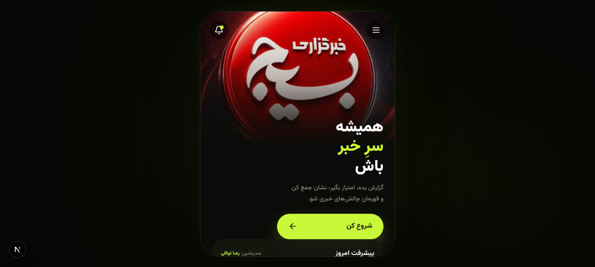
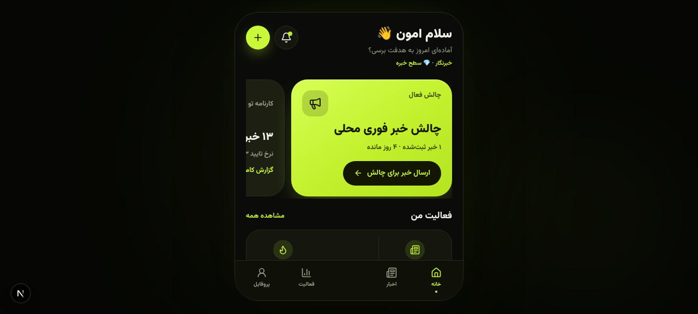
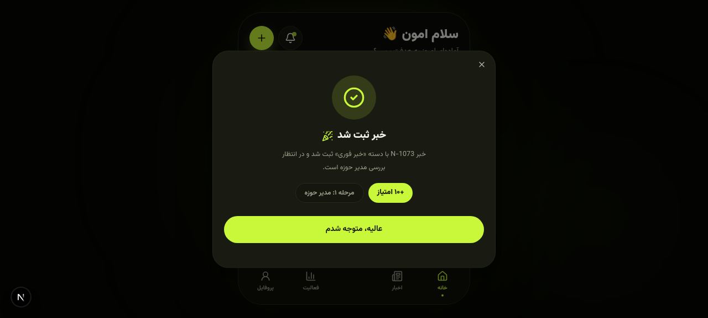

<div dir="rtl">

# 📰 خبرگزاری بشر — اپلیکیشن مدیریت خبرنگاران

<p align="center">
  
</p>

<p align="center">
  
  
  
  
  
  
</p>

اپلیکیشن موبایلی خبرگزاری سازمانی با **تم Candy** (سفید گرم + قرمز آجری + فیروزه‌ای): خبرنگاران خبر ثبت می‌کنند، چرخهٔ سه‌مرحله‌ای تایید (مدیر حوزه ← کارشناس خبر ← ادمین کل) را طی می‌کنند و با XP، سطح، استریک و نشان در تحریریه رقابت می‌کنند. 🏆

| 🚪 ورود | 🏠 خانه | 📤 ارسال خبر |
| --- | --- | --- |
|  |  |  |

## 🆕 آخرین به‌روزرسانی‌ها (نوامبر ۲۰۲۶)

- 🎨 **بازطراحی کامل رابط کاربری با تم Candy** طبق طراحی Stitch — پالت سفید گرم + قرمز آجری `#9d423a` + فیروزه‌ای، هدر شیشه‌ای با نقطهٔ زنده، ناوبری قرصی با FAB قرمز و اسپلش حلقه‌های لوگو
- 🏅 **صفحهٔ کارنامه و چالش‌ها** — کارت XP، ردیف ۵ سطح تحریریه (دستیافته/فعلی/قفل)، نوار پیشرفت ارتقا، کارت‌های استریک فعال و رکورد، حلقهٔ امتیاز دوره‌ای (روز/هفته/ماه) با نمودار هفتگی، گرید نشان‌های افتخار، جوایز برترین‌های ماه و رتبه‌بندی تحریریه
- 🛡 **پنل ادمین ارتقایافته** — KPI زنده، اقدامات راهبردی، فعال/غیرفعال‌سازی کاربران (قطع ورود حساب غیرفعال) و **لاگ زندهٔ امنیتی** (مدل `SecurityLog`)
- 📰 **کارت‌های خبر متحدالشکل** + لید خبر (`lead`) + خوانندهٔ خبر درون‌صفحه‌ای در خانه و فعالیت
- 💬 **تالار گفتگو و آموزش** به بالای صفحهٔ خانه منتقل شد (فقط ادمین/کارشناس مجاز به مدیریت)؛ ردیف استوری خبرنگاران حذف شد
- 🔔 تنظیمات اعلان کامل و قابل ویرایش (آموزش‌ها، هشدار صوتی، ساعت سکوت)

## ✨ امکانات

- 📝 **ثبت‌نام خبرنگار** در ۳ مرحله (نام/شماره، سن/تحصیلات، حوزه/پایگاه) — **اولین ثبت‌نام به‌طور خودکار ادمین کل سازمان می‌شود**
- 📤 **ارسال خبر** با دسته‌بندی (۸ دسته)، تیتر، لید، رسانه (عکس/ویدیو)، زمان تهیه و **کد پیگیری** (مثل N-1073)
- 🔄 **چرخهٔ تایید سه‌مرحله‌ای** نقش‌محور: مدیر حوزه (فقط حوزهٔ خودش) ← کارشناس خبر ← ادمین کل؛ **ادمین کل از هر مرحله‌ای می‌تواند نهایی کند**
- ❌ **رد با دلیل** (۴ دلیل استاندارد) + یادداشت و **ارسال مجدد** پس از ویرایش
- 🏆 **امتیاز / سطح / نشان**: ۵ سطح (تازه‌کار تا خبره)، ۶ نشان خودکار، استریک فعالیت روزانه و چالش خبری با رتبهٔ شخصی
- 📄 **پیش‌نویس** خبر با ذخیرهٔ خودکار + مدیریت و حذف
- 📊 **آمار زنده**: کارت پیشرفت امروز سازمان، نمودار هفتگی امتیاز، رتبه‌بندی و کارنامه
- 🔐 **نشست امن با کوکی HttpOnly** (امضای HMAC-SHA256) — جعل نقش ادمین با دستکاری `userId` ممکن نیست
- 📅 **تقویم جلالی** برای انتخاب روز و ساعت تهیهٔ خبر
- ⏰ **نگهداری خودکار**: پایان چالش‌های مهلت‌گذشته، یادآوری مهلت، انقضای درخواست‌های بی‌پاسخ، سقوط سطح پس از ۷ روز غیبت
- 📱 **اپ اندروید**: WebView اختصاصی با اسپلش و آیکون لوگو + پنجرهٔ تغییر آدرس سرور در قطعی اتصال

## 🏗 معماری و تکنولوژی

| لایه | تکنولوژی |
| --- | --- |
| 🖥 فرانت‌اند | Next.js 16 (App Router) · React 19 · TypeScript · Tailwind CSS 4 · shadcn/ui · Zustand |
| ⚙️ بک‌اند | API Routes · منطق امتیازدهی پورت‌شده از `scoring.py` ربات اصلی |
| 🗄 دیتابیس | SQLite + Prisma ORM (۱۴ مدل) · سازگار با Turso (libSQL) |
| 📱 اپ اندروید | WebView بومی (Java) — بدون وابستگیٔ اضافه |
| 🔐 احراز هویت | کوکی نشست HttpOnly با امضای HMAC-SHA256 (کلید: `SESSION_SECRET`) |
| 🔤 فونت و RTL | Vazirmatn · چیدمان کاملاً راست‌به‌چپ فارسی |

## 🚀 راه‌اندازی سریع

```bash
# ۱) نصب وابستگی‌ها
bun install        # یا: npm install

# ۲) کپی متغیرهای محیطی و ساخت کلید نشست
cp .env.example .env
# در .env مقدار SESSION_SECRET را بگذارید:  openssl rand -hex 32

# ۳) ساخت دیتابیس خالی (فقط اسکیما)
bunx prisma db push

# ۴) اجرای توسعه
bun run dev        # http://localhost:3000
```

> ⚠️ **نکته:** اگر `SESSION_SECRET` تنظیم نشود، یک کلید تصادفی موقت در حافظه ساخته می‌شود؛ در این حالت با هر ری‌استارت سرور، همهٔ نشست‌ها باطل می‌شوند. برای استقرار دائمی حتماً `SESSION_SECRET` را تنظیم کنید.

سپس در اپ: **ثبت‌نام خبرنگار جدید** — اولین حساب، ادمین کل سازمان است. 👑

### 🌱 دادهٔ نمونه (اختیاری)

```bash
bunx prisma db push && bun run scripts/seed.ts
```

### 📦 ساخت نسخهٔ production

```bash
bun run build && bun run start
```

## ☁️ استقرار رایگان (Vercel + Turso)

اپ با این ترکیب روی هاست رایگان دائمی اجرا می‌شود (هر دو سرویس، پلن رایگان بدون کارت بانکی دارند):

1. 🗄 **دیتابیس Turso** — در [turso.tech](https://turso.tech) با GitHub وارد شوید → **Create Database** (مثلاً `bashar-news`، لوکیشن Frankfurt) → کپی `Database URL` و `Database Token`
2. 🧱 **ساخت جداول** (یک بار، از کامپیوتر خودتان):

   ```bash
   DATABASE_URL="file:./db/custom.db" bunx prisma generate
   DATABASE_URL="libsql://bashar-news-xxxx.turso.io?authToken=YOUR_TOKEN" bunx prisma db push
   ```

3. ▲ **دیپلوی Vercel** — در [vercel.com/new](https://vercel.com/new) ریپو را Import کنید و در Environment Variables بگذارید:
   - `DATABASE_URL` = `file:./db/custom.db` (برای ساخت کلاینت)
   - `TURSO_DATABASE_URL` و `TURSO_AUTH_TOKEN` = مقادیر گام ۱
   - `SESSION_SECRET` = کلید تصادفی (`openssl rand -hex 32`) — **الزامی**
   - `SUPER_ADMIN_PHONE` = شمارهٔ ادمین کل (اختیاری — فقط سمت سرور خوانده می‌شود)
4. 📱 **اتصال اپ اندروید** — در APK هنگام قطعی اتصال اول، آدرس سرور Vercel را وارد و «اتصال» را بزنید.

> 💡 اپ به‌صورت خودکار دیتابیس ابری را تشخیص می‌دهد: اگر `TURSO_DATABASE_URL` تنظیم باشد از Turso استفاده می‌کند، وگرنه از فایل SQLite محلی.

## 📱 اپ اندروید

فایل آمادهٔ نصب: **[`apk/BasharNews-v1.0.0.apk`](apk/BasharNews-v1.0.0.apk)** (همچنین در [Releases](../../releases)).

- 🤖 حداقل اندروید: 7.0 (API 24) — همهٔ معماری‌ها
- 🎬 اسپلش لوگوی خبرگزاری بشر هنگام باز شدن + بارگذاری وب‌اپ
- 🔧 آدرس سرور پیش‌فرض در `android/res/values/strings.xml` (`default_server_url`)؛ کاربر می‌تواند هنگام قطعی اتصال، آدرس را از داخل اپ عوض کند (بدون بازسازی APK)

### 🔨 ساخت APK از سورس

سورس در [`android/`](android) است (Manifest + MainActivity + Resources). ساخت با build-tools:

```bash
# ۱) کامپایل منابع
aapt2 compile --dir android/res -o res.zip
aapt2 link -o base.apk -I $SDK/platforms/android-34/android.jar \
  --manifest android/AndroidManifest.xml -R res.zip --java gen --auto-add-overlay

# ۲) کامپایل جاوا و تبدیل به dex
javac -classpath $SDK/platforms/android-34/android.jar -d classes \
  gen/ir/basharnews/app/R.java android/java/ir/basharnews/app/MainActivity.java
d8 --release --lib $SDK/platforms/android-34/android.jar --output dex classes/**/*.class

# ۳) بسته‌بندی، تراز و امضا
zip -j base.apk dex/classes.dex
zipalign -f 4 base.apk aligned.apk
apksigner sign --ks keystore.jks --out BasharNews-v1.0.0.apk aligned.apk
```

## 🧪 تست‌های خودکار

```bash
# تست‌های API (نیازمند سرور در حال اجرا روی پورت ۳۱۰۰ و دیتابیس تازه)
BASE=http://localhost:3100 node scripts/e2e-smoke.mjs        # ۴۳ بررسی — از ثبت‌نام تا چرخهٔ تایید
BASE=http://localhost:3100 node scripts/ui-smoke.mjs          # ۱۳ بررسی رابط کاربری (Playwright)
BASE=http://localhost:3100 node scripts/ui-submit-picker.mjs  # ۱۰ بررسی تقویم جلالی
DATABASE_URL="file:./db/custom.db" node scripts/scheduler-test.mjs  # ۱۴ بررسی زمان‌بند نگهداری
node --experimental-strip-types scripts/verify-jalali.ts        # ۲۰ بررسی تقویم جلالی
```

## 📂 ساختار پروژه

```
├── src/app/api/          # اندپوینت‌های REST (state, news, review, resubmit, register, security-log, admin/stats, …)
├── src/components/app/   # صفحات و جریان‌های UI (Welcome, Home, Activity, Review, …)
├── src/lib/              # store (Zustand), domain (کاتالوگ‌ها و امتیازدهی), server/state
├── src/lib/server/       # نشست (session.ts)، اعلان‌ها، نگهداری دوره‌ای، ادمین کل
├── prisma/               # اسکیمای ۱۴ مدل
├── scripts/              # seed.ts (داده دمو) + تست‌های خودکار
├── android/              # سورس اپ اندروید (WebView wrapper)
├── apk/                  # APK امضاشده آماده نصب
└── docs/                 # اسکرین‌شات‌ها و آیکون
```

## 📄 لایسنس

MIT — فایل [LICENSE](LICENSE) را ببینید.

</div>

---

<div dir="ltr">

## 🌍 English Summary

**Bashar News Agency** — a mobile-first organizational newsroom app (Persian, full RTL) with a warm "Candy" theme (brick red + turquoise on warm white).

- 📝 Reporters register in 3 steps (the first account becomes super admin) and submit news with category, headline, lead, media, Jalali timestamp and a tracking code (e.g. `N-1073`).
- 🔄 Role-based 3-stage approval flow: district manager → news expert → super admin, with reasoned rejection and resubmission.
- 🏆 Gamification: XP, 5 editorial levels, 6 automatic badges, daily streaks, news challenges, monthly leaderboards and a redesigned scorecard page (Nov 2026).
- 🛡 Admin panel with live KPIs, user activate/deactivate and a live security log (`SecurityLog`).
- 🔐 Secure sessions via HMAC-SHA256-signed HttpOnly cookies — client-side role spoofing is impossible.
- 🧱 **Stack:** Next.js 16 (App Router) · React 19 · TypeScript · Tailwind CSS 4 · shadcn/ui · Zustand · Prisma + SQLite (14 models, Turso/libSQL-ready).
- 📱 Native Android WebView wrapper with splash screen; signed APK included in [`apk/`](apk) and Releases (Android 7.0+).
- ☁️ Free forever deployment on **Vercel + Turso** (step-by-step guide above), or self-host with the included Dockerfile.
- 🧪 100+ automated checks: API e2e smoke, Playwright UI smoke, Jalali calendar and scheduler tests.

**Quick start:** `bun install` → `cp .env.example .env` (set `SESSION_SECRET`) → `bunx prisma db push` → `bun run dev` → http://localhost:3000

</div>
