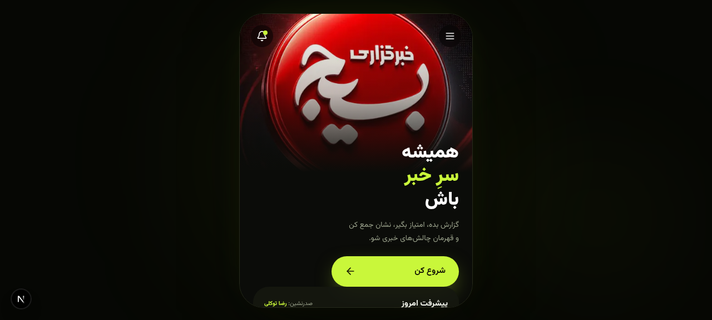
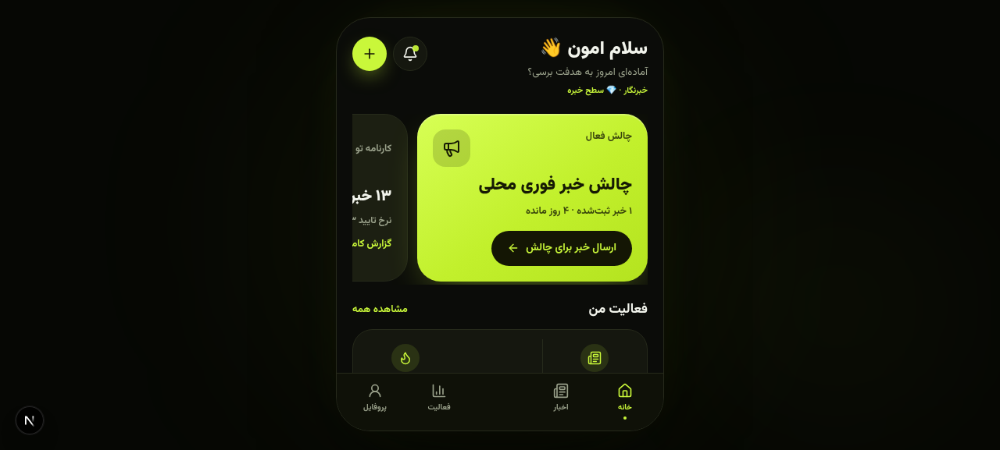
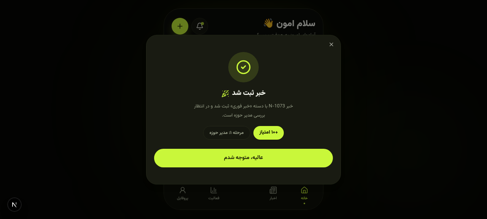

<div dir="rtl">

# خبرگزاری بشر — اپلیکیشن مدیریت خبرنگاران

اپلیکیشن موبایلی خبرگزاری سازمانی با تم تیره و سبز نئونی: خبرنگاران خبر ثبت می‌کنند، چرخه سه‌مرحله‌ای تایید (مدیر حوزه ← کارشناس خبر ← ادمین کل) را طی می‌کنند و امتیاز، سطح و نشان جمع می‌کنند.

<p align="center">
  
</p>

| ورود | خانه | بررسی |
| --- | --- | --- |
|  |  |  |

## امکانات

- **ثبت‌نام خبرنگار** در ۳ مرحله (نام/شماره، سن/تحصیلات، حوزه/پایگاه) — **اولین ثبت‌نام به‌طور خودکار ادمین کل سازمان می‌شود**
- **ارسال خبر** با دسته‌بندی (۸ دسته)، تیتر، لید، رسانه (عکس/ویدیو)، زمان تهیه و **کد پیگیری** (مثل N-1073)
- **چرخه تایید سه‌مرحله‌ای** نقش‌محور: مدیر حوزه (فقط حوزه خودش) ← کارشناس خبر ← ادمین کل؛ **ادمین کل از هر مرحله‌ای می‌تواند نهایی کند**
- **رد با دلیل** (۴ دلیل استاندارد) + یادداشت و **ارسال مجدد** پس از ویرایش
- **امتیاز / سطح / نشان**: ۵ سطح (تازه‌کار تا خبره)، ۶ نشان خودکار، استریک فعالیت روزانه
- **چالش خبری**: عضویت، ارسال خبر برای چالش، رتبه شخصی
- **پیش‌نویس** خبر + مدیریت و حذف
- **تنظیمات اعلان** + ساعت سکوت
- **آمار زنده**: کارت پیشرفت امروز سازمان در صفحه ورود، نمودار هفتگی امتیاز، رتبه‌بندی، کارنامه
- **اپ اندروید**: WebView اختصاصی با اسپلش و آیکون لوگو + پنجره تغییر آدرس سرور در قطعی اتصال

## معماری و تکنولوژی

| لایه | تکنولوژی |
| --- | --- |
| فرانت‌اند | Next.js 16 (App Router) · React 19 · TypeScript · Tailwind CSS 4 · shadcn/ui · Zustand |
| بک‌اند | API Routes (۹ اندپوینت) · منطق امتیازدهی پورت‌شده از `scoring.py` ربات اصلی |
| دیتابیس | SQLite + Prisma ORM (۱۱ مدل) |
| اپ اندروید | WebView بومی (Java) — بدون وابستگی اضافه |
| فونت و RTL | Vazirmatn · چیدمان کاملاً راست‌به‌چپ فارسی |

## راه‌اندازی سریع

```bash
# ۱) نصب وابستگی‌ها
bun install        # یا: npm install

# ۲) ساخت دیتابیس خالی (فقط اسکیما)
bunx prisma db push

# ۳) اجرای توسعه
bun run dev        # http://localhost:3000
```

سپس در اپ: **ثبت‌نام خبرنگار جدید** — اولین حساب، ادمین کل سازمان است.

### داده نمونه (اختیاری)

اگر برای تست به داده دمو نیاز داشتید:

```bash
bunx prisma db push && bun run scripts/seed.ts
```

### ساخت نسخه production

```bash
bun run build && bun run start
```

## استقرار رایگان (Vercel + Turso) — بدون هزینه

اپ با این ترکیب روی هاست رایگان دائمی اجرا می‌شود (هر دو سرویس، پلن رایگان بدون کارت بانکی دارند):

### گام ۱ — دیتابیس رایگان Turso (سازگار با SQLite)

1. به [turso.tech](https://turso.tech) بروید و با **GitHub** وارد شوید (رایگان)
2. **Create Database** → نام دلخواه (مثلاً `bashar-news`) → Location نزدیک: **Frankfurt (fra)**
3. بعد از ساخت، دو مقدار را کپی کنید:
   - `Database URL` — شبیه `libsql://bashar-news-xxxx.turso.io`
   - `Database Token` — از تب توکن‌ها بسازید

### گام ۲ — ساخت جداول در Turso (یک بار، از کامپیوتر خودتان)

```bash
DATABASE_URL="file:./db/custom.db" bunx prisma generate   # یک بار
DATABASE_URL="libsql://bashar-news-xxxx.turso.io?authToken=YOUR_TOKEN" bunx prisma db push
```

### گام ۳ — دیپلوی روی Vercel (رایگان)

1. به [vercel.com/new](https://vercel.com/new) بروید و ریپو `bashar-news-agency` را Import کنید
2. در بخش **Environment Variables** سه مقدار را اضافه کنید:
   - `DATABASE_URL` = `file:./db/custom.db` (برای ساخت کلاینت — استفاده نمی‌شود)
   - `TURSO_DATABASE_URL` = آدرس گام ۱
   - `TURSO_AUTH_TOKEN` = توکن گام ۱
3. **Deploy** را بزنید — بعد از یک دقیقه آدرس دائمی (مثل `https://bashar-news.vercel.app`) تحویل می‌گیرید

### گام ۴ — اتصال اپ اندروید

در APK، هنگام قطعی اتصال اول، آدرس سرور Vercel را در فیلد آدرس وارد و «اتصال» را بزنید — در دستگاه ذخیره می‌شود.

> نکته: اپ برای تشخیص خودکار دیتابیس ابری طراحی شده — اگر `TURSO_DATABASE_URL` تنظیم باشد از Turso استفاده می‌کند، وگرنه از فایل SQLite محلی. پلن رایگان Vercel هر ۱۵ ثانیه آماده نگه می‌دارد و Turso پلن رایگان تا ۵۰۰ دیتابیس و ۹ گیگ خواندن در ماه می‌دهد.

## اپ اندروید

فایل آماده نصب: **[`apk/BasharNews-v1.0.0.apk`](apk/BasharNews-v1.0.0.apk)** (همچنین در [Releases](../../releases) قابل دانلود است).

- حداقل اندروید: 7.0 (API 24) — معماری همه دستگاه‌ها
- اپ با باز شدن، **اسپلش لوگوی خبرگزاری بشر** را نشان می‌دهد و سپس وب‌اپ را بارگذاری می‌کند
- آدرس سرور به‌صورت پیش‌فرض در `android/res/values/strings.xml` (`default_server_url`) تنظیم شده است؛ کاربر هنگام قطعی اتصال می‌تواند آدرس را از داخل اپ عوض کند (در دستگاه ذخیره می‌شود)

### ساخت APK از سورس

سورس پوشه اندروید در [`android/`](android) است (Manifest + MainActivity + Resources). ساخت با build-tools:

```bash
# ۱) کامپایل منابع
aapt2 compile --dir android/res -o res.zip
aapt2 link -o base.apk -I $SDK/platforms/android-34/android.jar \
  --manifest android/AndroidManifest.xml -R res.zip --java gen --auto-add-overlay

# ۲) کامپایل جاوا و تبدیل به dex
javac -classpath $SDK/platforms/android-34/android.jar -d classes \
  gen/ir/basharnews/app/R.java android/java/ir/basharnews/app/MainActivity.java
d8 --release --lib $SDK/platforms/android-34/android.jar --output dex classes/**/*.class

# ۳) بسته‌بندی، تراز و امضا
zip -j base.apk dex/classes.dex
zipalign -f 4 base.apk aligned.apk
apksigner sign --ks keystore.jks --out BasharNews-v1.0.0.apk aligned.apk
```

## نکات استقرار

- اپ وب به دیتابیس SQLite نیاز دارد؛ برای استقرار دائمی، `DATABASE_URL` را تنظیم و `prisma db push` را اجرا کنید
- آدرس سرور داخل APK از `strings.xml` قابل تغییر است و نیازی به بازسازی APK ندارد (قابل ویرایش از خود اپ)

## ساختار پروژه

```
├── src/app/api/          # ۱۰ اندپوینت REST (state, news, review, resubmit, register, …)
├── src/components/app/   # صفحات و جریان‌های UI (Welcome, Home, Activity, Review, …)
├── src/lib/              # store (Zustand), domain (کاتالوگ‌ها و امتیازدهی), server/state
├── prisma/               # اسکیمای ۱۱ مدل
├── scripts/              # seed.ts (داده دمو), e2e-*.sh (تست‌های انتها به انتها)
├── android/              # سورس اپ اندروید (WebView wrapper)
├── apk/                  # APK امضاشده آماده نصب
└── docs/                 # اسکرین‌شات‌ها و آیکون
```
</div>
